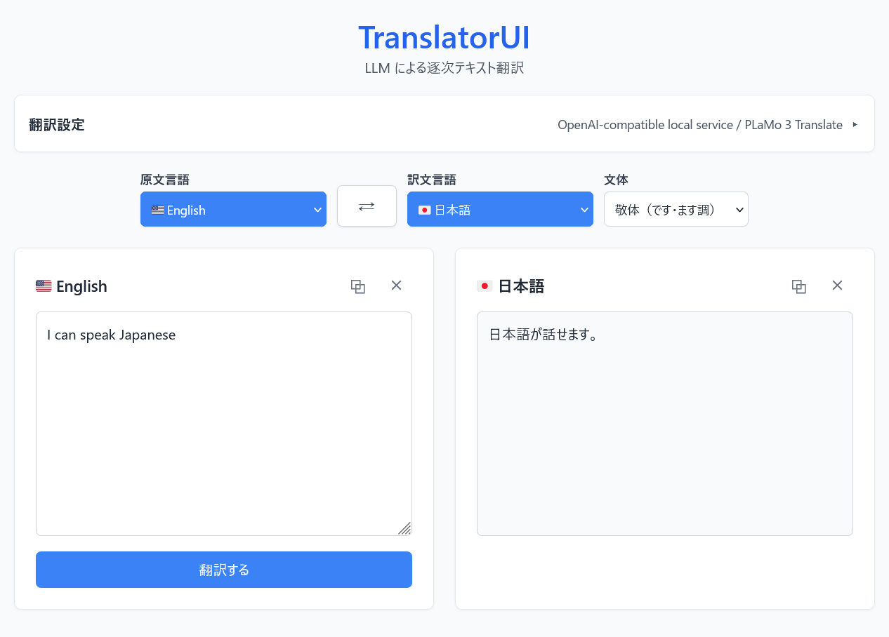

# LocaLingo

[日本語版はこちら](README-ja.md)

LocaLingo is a translation web UI that utilizes PLaMo's specialized large-scale language model for machine translation, developed by Preferred Networks. It operates in tandem with local LLM servers supporting OpenAI-compatible APIs, including LM Studio and Ollama.



In addition to text translation, the tool also supports PDF file translation. This functionality is achieved through a library called PDFMathTranslate, which performs translations while preserving the original document's formatting. The system can handle cases where PDF files contain images or diagrams without issue. (Note: Characters contained in images will not be translated.)


## Features

- **No character length limit**: While standard translation tools typically impose 2,000-character limits, LocaLingo has no such constraints. The maximum translation capacity depends on the restrictions of the LLM server in use—translations can span tens of thousands or even hundreds of thousands of characters.
- **Local operation**: Performs all translations locally without requiring an internet connection, ensuring data privacy protection.
- **User-friendly interface**: Provides an intuitive user interface that makes translation tasks straightforward and convenient.
- **Multilingual support**: Supports translations between numerous languages including English, Japanese, Chinese, Korean, French, German, and Spanish.
- **PDF translation capability**: Enables translation of PDF files while maintaining the original document's formatting.

## Setup Instructions

### Preparing the LLM Server

1. Install and launch a local LLM server supporting OpenAI-compatible APIs, such as LM Studio or Ollama.
2. Follow documentation like [pfnet/plamo-2-translate · Hugging Face](https://huggingface.co/pfnet/plamo-2-translate) or [mmnga/plamo-2-translate-gguf · Hugging Face](https://huggingface.co/mmnga/plamo-2-translate-gguf) to load the PLaMo translation model onto the LLM server.
3. Verify that the LLM server is running with OpenAI-compatible APIs. For LM Studio specifically, you need to enable the "Serve on Local Network" option.

To verify proper operation of the LLM server, execute the following curl command. Adjust port numbers and endpoints according to the specific LLM server in use:

```bash
curl http://localhost:1234/v1/chat/completions \
  -H "Content-Type: application/json" \
  -d '{
    "model": "plamo-2-translate",
    "messages": [
      {
        "role": "user",
        "content": "<|plamo:op|>dataset\ntranslation\n\n<|plamo:op|>input lang=English\nHello!\n<|plamo:op|>output lang=Japanese"
      }
    ],
    "stop": ["<|plamo:op|>", "<|plamo:reserved:0x1E|>"]
  }'
```

While the PLaMo translation model supports long-form translations, most LLM servers have output token length restrictions configured by default. Be sure to properly adjust the setting for maximum output token length.

### Running Locally Only

1. Open the compose.yml file and either comment out or remove the section related to tunneling. Also, configure the `LLM_ENDPOINT` environment variable to match the endpoint of your active LLM server.
2. Run the following command to launch LocaLingo:

```bash
sudo docker-compose up -d
```

### Parallel verification of the Python text-translation API

The PLaMo 3 Translate text API can be verified on port 4568 without changing the PDF API or
existing Ruby UI. Copy `.env.template` to `.env`, then set the actual model ID and endpoint exposed
by LM Studio. `LLM_ENDPOINT` must be the root URL without `/v1`.

On macOS, Linux, or WSL, run the wrapper from the repository root. It uses an existing `.venv`, or
creates one with Python 3.12 or newer, installs missing dependencies, and starts the API without
requiring virtual-environment activation:

```bash
./start-translator-ui.sh
```

On Windows PowerShell, use the PowerShell wrapper with the same name:

```powershell
.\start-translator-ui.ps1
```

By default, it binds only to `127.0.0.1:4568`. To make it reachable externally or use another
port, pass the corresponding arguments. On macOS, Linux, or WSL:

```bash
./start-translator-ui.sh --listen-host 0.0.0.0 --port 4568
```

On PowerShell:

```powershell
.\start-translator-ui.ps1 -ListenHost 0.0.0.0 -Port 4568
```

Use `--install-dependencies` / `-InstallDependencies` to explicitly refresh dependencies, or
`--recreate-venv` / `-RecreateVenv` to recreate an existing virtual environment. If `.env` does not
exist, either wrapper creates one from `.env.template` with `LLM_ENDPOINT=http://localhost:1234` for
direct host execution. Then confirm the actual model ID published by LM Studio.

`LLM_MODEL_ENDPOINT` and `LLM_CHAT_ENDPOINT` configure the model-list and Chat Completions API
paths independently. Standard OpenAI-compatible servers use the defaults `/v1/models` and
`/v1/chat/completions`. Each setting accepts either an absolute path on `LLM_ENDPOINT` or a complete
`https://...` URL, supporting non-standard paths and OpenAI-compatible endpoints on separate hosts.

After starting the service, check its health from another macOS, Linux, or WSL terminal:

```bash
curl http://localhost:4568/health
```

On PowerShell, use:

```powershell
Invoke-RestMethod http://localhost:4568/health
```

The expected response is `{"status":"ok"}`.

Keep `SAVE_TRANSLATIONS=false` during this stage so Ruby and Python do not concurrently update
`localingo/data/translations.json`. The Python MVP does not yet accept `auto` or `ja-easy`.

### Exposing the Service via Cloudflare Tunnel

For detailed instructions about Cloudflare's services, please refer to other documentation resources.

1. Open the compose.yml file and either comment out or remove the section related to the `LLM_ENDPOINT` environment variable. Set it to the endpoint of your active LLM server.
2. Create a .env file and configure the Cloudflare Tunnel authentication token in the `TUNNEL_TOKEN` environment variable.
3. If necessary, perform Cloudflare Access configuration. Without this setup, the translation service would become accessible globally to anyone.
4. Run the following command to launch LocaLingo:

```bash
sudo docker-compose up -d
```

## Important Notes

1. LocaLingo utilizes PLaMo's specialized translation model developed by Preferred Networks. Using the PLaMo translation model requires compliance with the PLaMo Community License. Specifically, individuals and small-to-medium businesses can use it freely—both for personal use and in non-commercial settings. However, large-scale commercial usage requires a separately negotiated license agreement. For details, please refer to the [PLaMo Community License](https://tech.preferred.jp/ja/blog/plamo-community-license/) and the [PLaMo Community License Agreement](https://plamo.preferredai.jp/info/plamo-community-license-ja).
2. LocaLingo itself does not contain any LLM server functionality. To operate it, you need a local LLM server supporting OpenAI-compatible APIs, such as LM Studio or Ollama.
3. By default, all translations are recorded. To disable translation data storage, set the `SAVE_TRANSLATIONS` environment variable in the compose.yml file to `false`.
